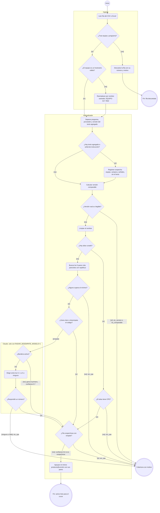
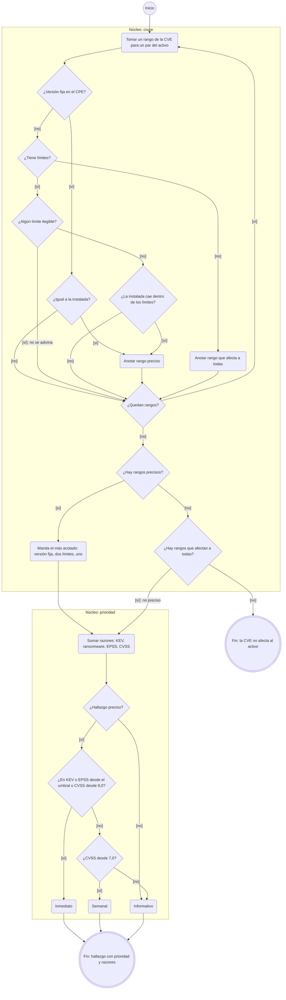
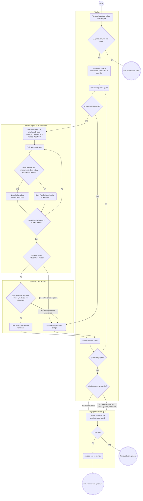
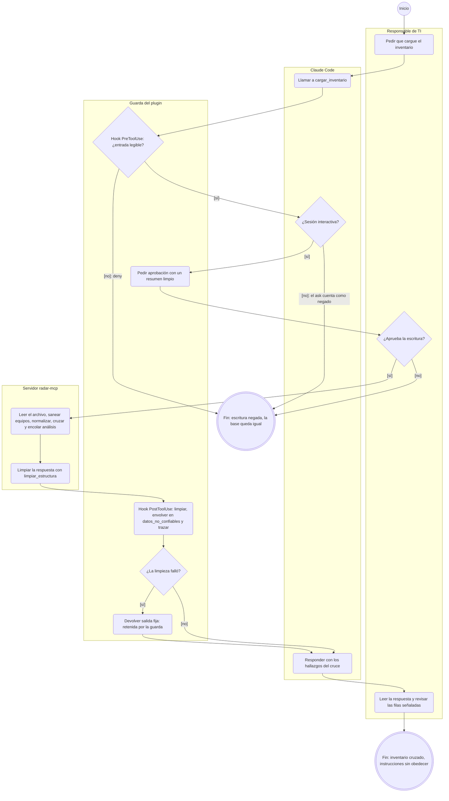

# Diagramas de actividades

Cuatro flujos de control internos del radar, en notación de actividades: dónde se decide,
qué camino toma cada rama y dónde termina. Complementan los diagramas de secuencia
([secuencia.md](secuencia.md)): la secuencia muestra quién le habla a quién; la actividad
muestra las decisiones. Cada sección abre con su caso de uso
([casos-de-uso.md](../casos-de-uso.md)), los archivos que lo implementan, el diagrama y la
decisión de diseño que explica su forma. Están en Mermaid para que GitHub los muestre sin
compilar nada.

| Cifra | Valor |
|---|---|
| Diagramas | 4 |
| Casos de uso que recorren | CU-01, CU-02, CU-03, CU-04 |
| Carriles en total | 13 |
| Finales que no son hallazgo ni texto del agente | cobertura, respaldo, escritura negada |

## Notación

| Elemento | Cómo se dibuja |
|---|---|
| Inicio | círculo `Inicio` |
| Acción | rectángulo redondeado |
| Decisión | rombo, con la guarda de cada salida entre corchetes: `[sí]`, `[no]` |
| Carril | recuadro con el nombre de quien hace la acción |
| Final de actividad | círculo doble `Fin` |
| Final de flujo | círculo doble con el destino (`Cobertura`, `Respaldo`): esa rama termina ahí y no vuelve a unirse |
| Bucle | flecha que vuelve a una acción anterior, con su guarda |

---

## CU-01 · Normalización de una fila del inventario

CU-01 · Cómo una fila del inventario termina en un activo con CPE o en cobertura con su
motivo, y dónde entra el modelo (solo en el empate, y solo con la bandera). Archivos:
`radar/ingesta/archivos.py`, `radar/ingesta/normalizador.py::normalizar`, `decidir`. Ver
también: [carga y cruce en secuencia](secuencia.md#cu-02--carga-de-inventario-y-cruce).

Por qué tiene esta forma: hay tres salidas a cobertura y ninguna a "hallazgo sin comparar"
(regla 1). La rama de la sospecha no corta el flujo: una fila con texto agregado se sigue
normalizando con el prefijo, porque mandarla a cobertura le daría al atacante justo lo que
pide (sacar el equipo de los hallazgos). Solo cae a cobertura si el prefijo no se reconoce o
queda en empate, y entonces se cuenta como posible inyección, no en silencio. El modelo está
en un carril propio que se puede apagar sin cambiar el resto: si falla, decide el código.

---

## CU-02 · Afectación y prioridad de una CVE sobre un activo

CU-02 · La regla de afectación de cada rango de NVD contra la versión instalada, cuál rango
manda y cómo se prioriza el hallazgo. Archivos: `radar/nucleo/cruce.py::afecta`,
`evaluar_cve`, `radar/nucleo/prioridad.py::priorizar`.

Por qué tiene esta forma: un límite ilegible no empareja, en vez de suponer que afecta
(nunca se adivina una versión). Un rango preciso gana sobre uno que afecta "a todas", y la
decisión "no preciso" sale antes de mirar KEV o CVSS: una CVE que NVD publica sin versión
queda informativa aunque esté en KEV, porque no se puede confirmar con la versión instalada.
Sin esa rama, cada versión sana de Chrome tendría 13 avisos inmediatos
([verificacion-validacion.md](../verificacion-validacion.md)). EPSS ausente agrega la razón
"sin dato" y no cuenta como bajo. Las entradas `vulnerable: false` no llegan a este flujo:
se descartan al leer NVD. La versión instalada ilegible tampoco: ya quedó en cobertura en CU-01.

---

## CU-03 · Análisis de un producto con verificador y respaldo

CU-03 · Lo que hace el worker por cada producto que exige acción, desde lanzar al agente
hasta guardar un texto que nunca queda vacío, y dónde entra la persona. Archivos:
`worker/principal.py`, `worker/analizar.py`, `radar/agente/analista.py`, `hooks.py`,
`verificador.py::decidir`, `respaldo.py`, `radar/api/rutas.py`. Ver también:
[ataque bloqueado en el analista](secuencia.md#cu-04--ataque-bloqueado-en-el-analista).

Por qué tiene esta forma: todos los caminos del carril del agente terminan en el verificador
o en el respaldo, y los dos llevan a guardar. No hay una salida en la que el producto quede sin
texto (regla 6). El verificador no tiene modelo: compara contra los textos de NVD y las cifras
del grupo, nunca contra el inventario. Un hook que falla niega la llamada (`on_failure="block"`)
en vez de dejarla pasar. La persona está al final y fuera del bucle: el radar redacta y
verifica, pero solo una persona con nombre aprueba, y un análisis nuevo borra esa aprobación.

---

## CU-04 · Carga desde Claude Code con la guarda del plugin

CU-04 · Qué pasa cuando alguien pide en Claude Code cargar un inventario que puede venir
envenenado: la aprobación antes de escribir, la limpieza después y lo que pasa si una de
las dos falla. Archivos: `plugin/hooks/`, `plugin/scripts/aprobar_escritura.py`,
`limpiar_salida.py`, `radar/mcp/servidor.py`. Ver también:
[ataque bloqueado en el plugin](secuencia.md#cu-04--ataque-bloqueado-en-el-plugin).

Por qué tiene esta forma: las tres ramas que no son la aprobación explícita terminan en el
mismo final (escritura negada), así que la falla del hook, la sesión sin persona y el "no"
dan el mismo resultado. La limpieza está dos veces, en el servidor y en el hook, porque un
`PostToolUse` que falla deja pasar el texto original aunque tenga `onFailure: block`
(verificado el 14 de noviembre de 2026); por eso la rama de falla devuelve una salida fija
y no el texto. Un nombre de equipo válido como hostname pero con forma de instrucción pasa el
saneo: lo que lo contiene es que sigue limpio y marcado como dato (ver
[LIMITES.md](../LIMITES.md)).
