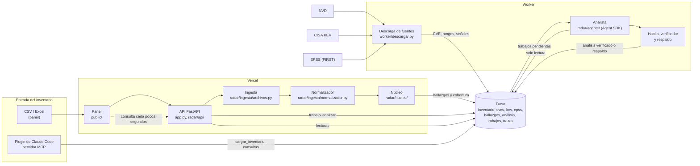
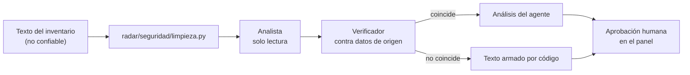

# Diagrama de componentes

Las piezas del radar y qué datos pasan entre ellas. La base de datos es el punto de encuentro:
ninguna pieza llama a otra directamente salvo la API al núcleo. Para saber dónde corre cada
una, ve a [despliegue.md](despliegue.md).

| Cifra | Valor |
|---|---|
| Lugares de ejecución | 4 (Vercel, Turso, worker, portátil con el plugin) |
| Piezas que leen texto no confiable con un modelo | 1 (el analista), aislada de la capa web |
| Fuentes externas | 3 (NVD, CISA KEV, EPSS) |

## Vista general

CU-01, CU-02 · Carga de inventario y cruce. CU-03 · Análisis con aprobación del comunicado.

## Qué hace cada pieza

| Pieza | Archivos | Entra | Sale |
|---|---|---|---|
| Panel | `public/index.html`, `panel.js`, `estilo.css` | Respuestas de la API | Pantalla del responsable de TI; cambios de estado y aprobaciones |
| API | `app.py`, `radar/api/rutas.py`, `datos.py`, `acceso.py` | Archivo de inventario, cambios de estado, clave compartida | JSON para el panel; trabajos en la cola |
| Ingesta | `radar/ingesta/archivos.py` | Bytes de CSV o Excel | Filas como texto, descartes con motivo, duplicados |
| Normalizador | `radar/ingesta/normalizador.py` | Filas de inventario | Activos `producto@versión` con pares CPE, o cobertura con motivo |
| Núcleo | `radar/nucleo/` | Activos, CVE y señales guardadas | Hallazgos priorizados, cobertura y grupos por producto |
| Descarga | `worker/descargar.py`, `radar/fuentes/` | NVD, KEV, EPSS (o el snapshot local) | CVE, rangos y señales en la base, y qué fuente respondió |
| Analista | `radar/agente/analista.py`, `herramientas.py`, `instrucciones.py` | Hallazgos de un producto, por herramientas de solo lectura | Análisis, remediación y comunicados estructurados |
| Guarda | `radar/agente/hooks.py`, `verificador.py`, `respaldo.py`, `radar/seguridad/` | Cada llamada a herramienta y la salida del modelo | Decisión permitida, negada o limpiada; texto verificado o respaldo por código |
| Plugin | `plugin/`, `radar/mcp/` | Pedidos desde Claude Code | Inventario cargado y consultas sobre hallazgos |

## Frontera de confianza

El texto del inventario es no confiable de punta a punta. La capa web lo guarda y lo muestra
escapado, pero nunca lo pasa a un modelo con herramientas. El único que lo lee con un modelo
es el analista, que corre fuera de Vercel, con conexión de solo lectura a la base y con hooks
que bloquean ante cualquier falla.

Diagramas del mismo flujo: [despliegue.md](despliegue.md), [secuencia.md](secuencia.md).
