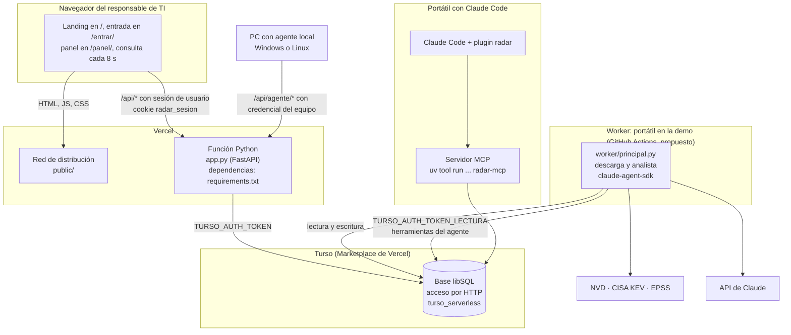

# Diagrama de despliegue

Dónde corre cada pieza y por qué. La regla de fondo: lo que lee texto no confiable con un
modelo (el analista) no corre en el mismo lugar que lo que atiende a los usuarios (la API).
Para el detalle de cada pieza, ve a [componentes.md](componentes.md).

| Cifra | Valor |
|---|---|
| Bases de datos | 1 (Turso, compartida por panel, worker y plugin) |
| Lugares de ejecución | 5 (con los PC que llevan el agente local) |
| Tiempo máximo de una función de la API | 300 s (`vercel.json`) |
| Tamaño máximo de un inventario subido | 4.5 MB (límite de Vercel) |

## Vista general

## Nodos

| Nodo | Qué corre | Por qué ahí |
|---|---|---|
| Vercel, red de distribución | `public/` (panel sin framework ni compilación) | Vercel lo sirve directo |
| Vercel, función Python | `app.py`: carga de inventario, normalización, cruce, estados | El cruce es código determinista y responde al instante |
| Turso | Inventario, CVE, señales, hallazgos, análisis, trabajos, trazas | Base compartida accesible por HTTP desde Vercel, el worker y los portátiles |
| Worker | Descarga de fuentes y analista con el Agent SDK | El SDK lanza un proceso `claude` con consola, directorio de trabajo y archivos de sesión; su guía de hospedaje pide contenedor o sandbox, no una función |
| Portátil con Claude Code | Plugin y servidor MCP | Quien instala el plugin solo necesita `uv` |

## Decisiones de despliegue

| Decisión | Problema que resuelve |
|---|---|
| `.vercelignore` deja fuera `pyproject.toml` y `uv.lock` | Con los dos presentes, el builder de Python de Vercel (`@vercel/python` 6.58.0) instala desde `uv.lock` con `uv sync --no-dev` sin extras e ignora `requirements.txt`: FastAPI, que está en el extra `api`, no se instalaría |
| `requirements.txt` sin `claude-agent-sdk` | El SDK trae el binario de Claude Code y no se usa en Vercel |
| Driver `turso_serverless` | Es Python puro sobre HTTP, sin extensión nativa: funciona en una función de Vercel |
| Sesión por usuario con roles (lector, analista, admin) | La URL es pública y cada carga gasta créditos de Claude. Las personas entran en `/entrar/` y la sesión vive en la base (se revoca de verdad); el rol decide qué pueden cambiar (RF-610 a RF-612) |
| Clave compartida en `X-Clave-Acceso` solo para programas | Scripts, pruebas y el agente en `subir-csv`. En Vercel, sin sesión y sin `CLAVE_ACCESO` la API responde 503 en vez de quedar abierta |
| Agentes con credencial propia y aprobación | Cada PC se inscribe con un token que caduca y queda pendiente hasta que una persona lo aprueba en el panel (RF-819); su credencial solo sirve para reportar por ese equipo y se revoca sin tocar a los demás |
| Consulta periódica en vez de SSE | Más simple en funciones sin estado |
| Token de solo lectura para el agente | `turso db tokens create <base> --read-only`. Además, la conexión del agente rechaza toda sentencia que no sea `SELECT` |

## Variables de entorno

| Variable | Dónde |
|---|---|
| `TURSO_DATABASE_URL`, `TURSO_AUTH_TOKEN` | Vercel y worker |
| `TURSO_AUTH_TOKEN_LECTURA` | Worker (herramientas del agente) |
| `ANTHROPIC_API_KEY` | Worker y Vercel |
| `NVD_API_KEY` | Worker |
| `CLAVE_ACCESO` | Vercel |
| `CVE_UMBRAL_EPSS`, `CVE_UMBRAL_CVSS`, `CVE_UMBRAL_CVSS_SEMANAL` | Vercel |

Los valores viven solo en `.env` y en las variables de Vercel y de GitHub. Los nombres están en
`.env.example`.

## Lo que todavía no está

- El worker con horario en GitHub Actions: no se ha probado el Agent SDK ahí, y GitHub retrasa
  las corridas programadas en cuentas gratuitas.
- Vercel Sandbox como lugar del worker: encaja con lo que pide la guía del SDK, pero no se evaluó.

Diagramas del mismo flujo: [componentes.md](componentes.md), [secuencia.md](secuencia.md).
